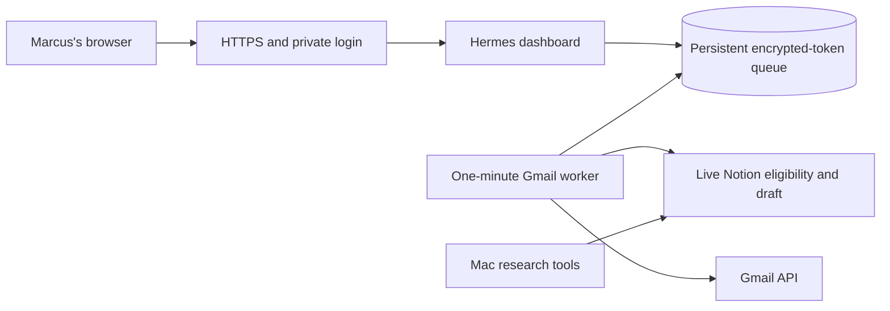

> Marcus OS now offers Composio MCP login without an API key. Set `COMPOSIO_MCP_CALLBACK_URL` to your HTTPS host plus `/api/composio/mcp/callback` for that login. The standalone mail queue below still describes its existing direct/REST transports. MCP sign-in does not complete hosted mail acceptance.

# Marcus OS persistent host

Gmail now defaults to Composio. Configure its project API key, managed Gmail auth config ID, stable user ID and public HTTPS callback in `runtime.env`. See [Composio Gmail](../../docs/composio-gmail.md). The direct Google setup below applies only with `GMAIL_PROVIDER=google`. Existing service names and disk paths stay compatible.

# Paid-host deployment review

Status: prepared for review. Nothing purchased, uploaded, deployed or enabled.

## Proposed host

One DigitalOcean Basic Regular Droplet, 2 GiB memory, 1 vCPU, 50 GiB disk, $12/month before taxes, backups, domain or excess usage. Price checked October 20, 2026 on the [official pricing page](https://www.digitalocean.com/pricing/droplets). This is a proposed small-workload size, not a measured production capacity result.

Run the Next dashboard and a separate Gmail worker on the same persistent server. SQLite transactions coordinate both processes. No Vercel Cron or separate paid database is needed for this single-instance design. The existing Mac stays available for Claude finder and local production tools.

Jev evaluated persistent VM versus a serverless rewrite using the current code and requirements. It chose the persistent VM with confidence 0.97. This supports the architecture choice; it does not approve spending or prove deployment.

## Files

- `hermes-web.service`: loopback-only web process.
- `hermes-mail.service`: separate worker, no public send endpoint.
- `Caddyfile.example`: HTTPS reverse proxy with authentication on every route.
- `caddy-override.conf`: reads the private Caddy environment file.
- `runtime.env.example` and `caddy.env.example`: names and placeholders only.
- `preflight.mjs`: checks local configuration without contacting providers.
- `make-review-bundle.py`: source archive, excluding local data, environment files, caches and symlinks. It does not upload anything.

## Required private setup

Use a maintained Linux release with systemd, Caddy and Node 26. Pin and verify the official Node distribution on the host. The current implementation uses `node:sqlite` and direct TypeScript loading. Do not use an older runtime just because it ships with the OS.

Create a dedicated `hermes` service user. Place source at `/opt/hermes/app`, runtime data at `/var/lib/hermes`, and secret files at `/etc/hermes`. The data directory must be owned by `hermes` with mode 0700. Secret environment files must be mode 0600 and readable by the service manager, never committed.

Set `HERMES_PERSISTENT_DISK_CONFIRMED=true` only after verifying that this directory survives a server restart. The default example leaves it false and blocks mail storage activation.

Allow public HTTPS/HTTP for Caddy and restrict SSH to the administrator. Do not expose port 3200. The supplied web unit binds it to loopback. Authentication is required for every page and API route. Host and Origin checks alone are not login protection.

Choose a subdomain, point its DNS to the server, and set the same hostname in Caddy, `DASHBOARD_HOSTS` and the registered Google OAuth callback. Generate the Caddy password hash interactively with `caddy hash-password`. Do not place a plaintext password in Caddy's configuration.

Create Google's OAuth web client with Gmail API enabled and the consent screen in production. Register `https://YOUR_HOST/api/gmail/callback`. Store the client ID, client secret and a fresh 32-byte base64 encryption key in the private environment. Back up the encryption key separately from the queue.

Create or use a Notion integration shared with the Lead Research parent and all five sources. Its server token is `NOTION_API_TOKEN`. Existing Mac MCP authentication is not copied or used by this host.

The reviewed source IDs are:

| Source | Data source ID |
|---|---|
| Companies | e52e94bc-1536-4467-b595-80cafadf63fa |
| People | a814d082-803b-4f07-b69d-81afadd329cb |
| Opportunities | db4cc901-64e1-407a-92bb-b8aa51c95925 |
| Evidence | 7ea54a55-a293-4ba4-96cd-e501416fd9f7 |
| Run Log | 9ce0dd98-b540-4277-9c2d-e2530e12388c |

## Deployment sequence after approval

1. Review the price, provider, hostname and data transferred. Obtain approval before provisioning or uploading.
2. Create the server, configure SSH and firewall, install verified Node and Caddy, and create the directories and service user above.
3. Review and upload the source-only archive. Do not upload `.env.local`, Hermes profiles, Mac credentials, the whole home folder or unreviewed databases. Historical delivery and suppression migration is a separate, required cutover step.
4. On the host, run `npm ci`, `npm run build`, `npm run typecheck`, `npm run lint` and `node --test tests/persistent-mail.test.mjs tests/notion-read-adapter.test.mjs tests/bulk-email.test.mjs` inside `/opt/hermes/app`. The full test suite is checked on the Mac before packaging; two integration tests require local Hermes and research installations absent from this host. Build capacity has not been measured; do not silently buy a larger plan if it fails.
5. Create `.next/cache`, make only that cache directory writable by the web service, and fill the private environment files. Run the preflight as `hermes` using a private environment loader. Do not print the environment.
6. Validate the Caddy configuration on the host, then install the reviewed service files. Start only the authenticated web UI first. Confirm unauthenticated access returns 401 and direct public port 3200 is unreachable.
7. Enter the business identity and limits on the host. Leave morning, agent generation, Gmail release and Telegram alerts off. Connect Gmail in the private host UI.
8. Marcus explicitly clicks the self-test button and verifies receipt. Repeat this check with the Mac off. No lead send is needed for this test.
9. Turn off both the legacy CRM sender and Mac Gmail automatic sender. Only then set `HERMES_LEGACY_SENDER_DISABLED=true` on the host. This is an operator attestation, not remote detection.
10. Before starting the worker, reconcile all historical sent, uncertain and suppressed records from both old senders. Review a separate migration and verify permanent blocks and sent history on the host. Pending emails require fresh host previews and approvals. An empty history is not acceptable for previously contacted leads. Only after that review set `HERMES_HISTORY_RECONCILED=true`, then start the Gmail worker. This is a separate required operator attestation, not an automatic migration check. Its release switch still defaults off. Review one current Notion draft, approve the exact email, explicitly activate release and resume the queue only when ready.

The host starts with a new queue file, but sending must stay off until historical delivery and suppression records are reconciled and migrated. Do not restore or import a live Mac queue into it without reconciling every sent, queued and uncertain item. Two active senders must never share the same outreach job.

Automatic Notion stage writes are off by default on the host. Notion does not offer an atomic conditional update for these page writes. A fresh revision check reduces conflicts but cannot eliminate a simultaneous human edit between checking and writing. Keep `HERMES_NOTION_STAGE_WRITES_APPROVED=false` until this limitation is reviewed. Sending suppression and delivery receipts still live in the durable queue.

## Required acceptance checks

- Authenticated HTTPS works. Tokens never appear in page data or logs.
- A self-test is received with the Mac off.
- A current Notion draft can be read and previewed with its full signature.
- Changed drafts and Do not contact records are blocked.
- Worker restart preserves approved items and never retries uncertain sends.
- Exactly one approved email is released, with the configured window, cap and spacing.
- Reply and bounce checks suppress the sequence and pause when required.
- Backups restore to a paused queue on an isolated instance, with no send during restore.

## Backups and rollback

Stop release before a database backup or migration. Copy SQLite with an online backup API or while both services are stopped; do not copy only a live `.sqlite` file and omit its WAL. Keep encrypted backups outside this server and keep the encryption key separately. Backup cost and destination are not yet selected.

To roll back, stop the mail worker first, pause the queue, preserve its database and receipts, and restore the previous application release. Never roll back the send ledger to an older snapshot and resume sending. Reconcile Gmail Sent mail before any uncertain item is handled.

## Limits

This is a single server, not a highly available service. OS updates, disk health and backups need an owner. The package is not deployed and Mac-off acceptance is not complete.

The hosted scope is the lead read and Gmail workflow. Claude finder, agent profile editing, media production, Clients MCP writes and Apify's local Python integration are not made portable by these service files. The existing Vercel bridge is unchanged.

Sources: [Caddy authentication](https://caddyserver.com/docs/caddyfile/directives/basic_auth), [Node SQLite](https://nodejs.org/api/sqlite.html), [Google refresh-token rules](https://developers.google.com/identity/protocols/oauth2#expiration).
